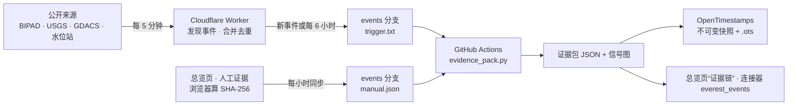

# EVEREST

**公开地球观测数据的真实度审计和事件证据平台**
*Truth audit and event evidence for public Earth-observation data*

[总览页](https://claude.ai/artifact/6heopu2wizEAFMJJLDs44H) · [总览页说明](docs/HUB_GUIDE.md) · [连接器（MCP）](https://everest-facets.yizebaba.workers.dev/mcp) · [实时采集页](https://everest-facets.yizebaba.workers.dev/rt) · [证据包数据](https://github.com/Yizebaba/EVEREST-/tree/events) · [English](#english)

---

灾害发生后，地震台、水位站、网络连通、卫星目录各自都留下了记录，但分散在不同机构、不同格式里，有的还会断档、会被覆盖。
EVEREST 不产生新数据，它做三件事：

| | 做什么 | 结果 |
|---|---|---|
| **真实度审计** | 持续记录每个公开来源是否在线、延迟多少、哪里断档 | 停报本身就是一条证据：哪个站在什么时候没了数据 |
| **事件证据包** | 自动发现事件，把各来源对齐到同一条时间线，标出“支持 / 缺失 / 矛盾” | 每个事件一份 JSON + 两台站地震信号图 |
| **存证** | 每一版证据包存不可变快照，用 OpenTimestamps 加公开时间戳 | 任何人都能核对：这份文件最晚在哪个比特币区块时已经存在、之后没被改过 |

**只监测，不预测。** 不发预警、不给风险概率、不做天气预报、不判断责任或成因。

## 一个例子：2026-10-11 Gorkha 洪水

Worker 从 BIPAD 洪水警报里自动发现事件（Aarughat-9, Gorkha），证据包自动生成。节选：

| 时间 (UTC) | 来源 | 记录 | 判定 |
|---|---|---|---|
| 10-10 13:31 | IO.EVN 地震台（珠峰，217 km） | 1–5 Hz 信号约背景 23 倍 | 支持 |
| 10-10 13:31 | KKN 地震台（加德满都北，84 km） | 同一时刻没有记录到 → 更可能是珠峰附近的局部震动 | **矛盾** |
| 10-10 14:39 | KKN + IO.EVN | 两台同时有强信号 | 支持 |
| 10-10 18:37–01:53 | IO.EVN | 436 分钟没有数据 | **缺失** |
| 10-10 22:40 | KKN | 信号约背景 60 倍；IO.EVN 此时无数据，无法核对 | 支持 |
| 10-11 02:05 | BIPAD 灾害警报 | Flood warning at Aarughat-9, Gorkha | 支持 |
| 10-11 04:57 | Sentinel-2 | 事件后第一景（云量 20%），可与 10-06 对比 | 支持 |
| 10-13 | BIPAD 水位站 | 80 km 内 12 站只有 9 站在报，Budhi Gandaki at Aarughat 停报 | **缺失** |
| 10-13 | IFRC Montandon | 需要 IFRC GO 令牌（未配置） | **缺失** |

完整时间线：[`events/bipad-gorkha-2026-10-11.json`](https://github.com/Yizebaba/EVEREST-/blob/events/events/bipad-gorkha-2026-10-11.json)。证据包写明“谁没记录到”，和“谁记录到了”同等重要。

## 证据链怎么生成



| 环节 | 来源 |
|---|---|
| 发现事件 | BIPAD 洪水警报（喜马拉雅高山区县）、USGS 崩塌、GDACS 橙/红级、水位越线；新闻线索（两家以上媒体报道的雪崩、冰湖溃决、泥石流、滑坡、暴雪）；36 小时 / 150 km 内合并 |
| 地震台 | IO.EVN（GEOFON）与 NK.KKN（EarthScope）两台核对；缺数时段标“缺失”，一台有一台没有标“矛盾” |
| 民间地震仪 | Raspberry Shake：事件 150 km 内最近两台 |
| 地震目录与产品 | USGS、EMSC；USGS 震动图、公众有感报告、PAGER（标明是模型估计）；M5 以上时看附近 GNSS 站位移（NGL） |
| 水位站 | 事件 80 km 内的 BIPAD 站：谁在报、谁停了 |
| 网络连通 | IODA（所在区 BGP、主动探测） |
| 卫星 | Sentinel-1/2 前后影像（Planetary Computer）；哥白尼 GFM 自动洪水范围 |
| 国际记录 | 哥白尼应急制图（EMS）；IFRC Montandon（需令牌）；Vantor 开放高分影像 |
| 新闻与公开记录 | GDELT 全球新闻；维基百科新建条目；OCHA HDX；ReliefWeb（需 appname） |
| 断电、火点 | NASA 夜间灯光（需 Earthdata）、Cloudflare Radar（需令牌）、NASA FIRMS（需 MAP_KEY） |
| 太阳活动 | 地磁 Kp 指数（GFZ）：作为背景，地磁暴时 GNSS 和卫星通信可能受影响 |
| 人工证据 | 总览页上传的照片、视频、链接、现场记录。全部公开指纹并存证；所有者核实为“已采信”后才公开内容、进入时间线；提交人和文件本身不公开 |
| 存证 | 每一版证据包和人工证据清单都存快照并加 OpenTimestamps 时间戳，之后自动升级为比特币区块确认 |

在总览页“证据链 → 证据源”里可以登记新的来源，所有者评估后决定是否接入。各灾种能留下哪些公开记录，见 [`docs/EVIDENCE_SOURCES.md`](docs/EVIDENCE_SOURCES.md)。

### 自己核对一份存证

```bash
pip install opentimestamps-client
# 从 events 分支 events/archive/ 下载快照和同名 .ots，放在一起
ots verify events/archive/<事件编号>_<哈希>.json.ots
```

文件改动一个字节，核对就会失败。

## 怎么用

- **总览页**（主界面）：<https://claude.ai/artifact/6heopu2wizEAFMJJLDs44H>。左侧“证据链”看事件、上传证据、登记证据源；“运行状态”看各来源在线情况。
- **在 Claude 里提问**：设置 → 连接器 → 添加自定义连接器，名称 `EVEREST`，地址 `https://everest-facets.yizebaba.workers.dev/mcp`（提示无法检查登录方式时选“仍然继续”）。15 个只读工具，例如 `everest_events`、`everest_daily_brief`、`everest_offline`。
- **Claude Code 插件**（连接器 + 8 个技能）：
  ```
  /plugin marketplace add Yizebaba/EVEREST-
  /plugin install everest@everest
  ```
- **直接取数据**（公开 JSON）：
  - 事件目录：`https://raw.githubusercontent.com/Yizebaba/EVEREST-/events/index.json`
  - 实时快照：`https://raw.githubusercontent.com/Yizebaba/EVEREST-/facet-live/rt.json`
  - 事件接口：`https://everest-facets.yizebaba.workers.dev/api/events.json`

## 边界

- **不预测、不预警**：那是国家项目的职责（例如 UNDP 执行的冰湖项目 GCF FP272）。
- **不做天气预报**。
- **不对中国境内公众发布地图**：需要审图、服务器在境内（《地图管理条例》第十五、三十四条）。
- **重计算不在 GitHub 跑**：InSAR 干涉在哥白尼 openEO，坡面雷达统计在 Planetary Computer；GitHub 只跑取数、画图这类小任务。
- **只用公开方法**：方法和参数都在仓库里，结果可复现。

定位依据与核实记录：[平台定位调研](https://claude.ai/code/artifact/e72d61c9-b06d-4230-b8e1-59741d620a58)（法律部分是对公开文本的解读，不是法律意见）。

## 仓库结构

| 路径 | 内容 | 运行在 |
|---|---|---|
| `cf-worker/` | 实时采集、事件发现（`src/events.js`）、坡面雷达监测、EVEREST 连接器 `/mcp` | Cloudflare Worker |
| `tools/evidence_pack.py` | 证据包生成、OpenTimestamps 存证 | GitHub Actions（`evidence.yml`，events 分支） |
| `tools/manual_export.py` | 总览页人工证据 → `manual.json` | 同步任务 |
| `tools/hub_sync.py`、`tools/monitor_sync.py` | 实时数据和证据包 → 总览页数据库（后备；页面打开时直接经连接器订阅，有更新就变） | 同步任务 |
| `pipeline.py`、`cloud_insar_pipeline.py`、`models/` | 每日 InSAR 管线：读云端干涉结果，没有新结果标“不可观测” | GitHub Actions（`daily-pipeline.yml`）+ openEO |
| `hub/` | 总览页源文件、能力声明、复原记录 `RESTORE.md`、自检脚本 | claude.ai |
| `plugin/` | 插件：连接器配置 + 技能（`plugin/skills/*/SKILL.md`） | Claude / Claude Code |

**数据分支**（自动写入，不要手改，不要合并进 main）：

| 分支 | 内容 |
|---|---|
| `events` | 事件目录、证据包、信号图、存证快照与 `.ots`、`manual.json` |
| `facet-live` | 实时快照、坡面进度、云图 |
| `adsb-live` | ADS-B 中转、连接器外部健康检查 |
| `live-data`、`insar-out` | 旧采集结果、早期云端干涉结果 |

## 复原

每次改动都在 [`hub/RESTORE.md`](hub/RESTORE.md) 记一条：改了什么、线上版本号、怎么回退。证据包和存证快照只增不改，历史版本都在 `events` 分支的提交记录里。

早期的 InSAR 管线说明（含已不在范围内的预警设想）存档在 [`docs/LEGACY_INSAR.md`](docs/LEGACY_INSAR.md)。

---

<a name="english"></a>
## English

EVEREST does not produce new data. After a disaster, seismic stations, river gauges, connectivity monitors and satellite catalogues each leave records, scattered across agencies, and some go missing or get overwritten. EVEREST:

1. **Audits** whether each public source is online, how late it is, and where it breaks. A station going silent is itself evidence.
2. **Builds an evidence pack** for every auto-detected event: one timeline across sources, each entry marked supporting, missing or contradictory. For example, a strong signal at the Everest station that the Kathmandu station did not record is marked contradictory: more likely local to Everest than part of the flood.
3. **Timestamps** every version with OpenTimestamps, so anyone can verify that a pack existed by a given Bitcoin block and has not changed since.

People can also submit photos, videos, links and field notes through the hub. Fingerprints are published and timestamped for all of them; content enters the public timeline only after the owner marks it accepted. Submitter names and the files themselves stay private.

**Monitoring only:** no prediction, no warnings, no weather forecasts, no attribution of cause or blame.

- Hub: <https://claude.ai/artifact/6heopu2wizEAFMJJLDs44H>
- MCP connector (15 read-only tools): `https://everest-facets.yizebaba.workers.dev/mcp`
- Evidence data: the [`events`](https://github.com/Yizebaba/EVEREST-/tree/events) branch
- Verify a stamp: `pip install opentimestamps-client`, then `ots verify <snapshot>.json.ots`
